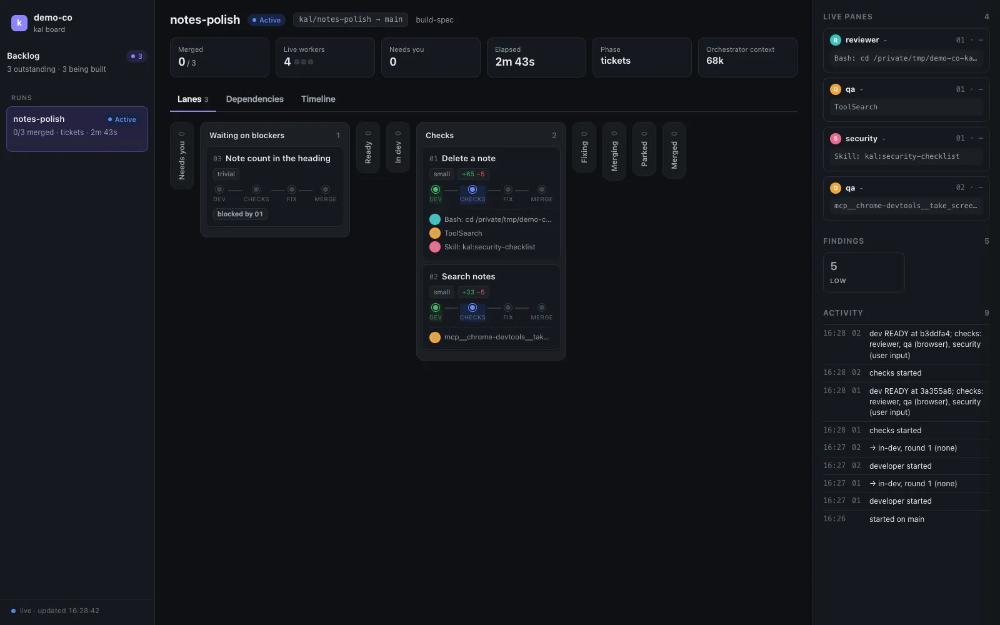

# kal

[](https://github.com/donovangriggs/kal/actions/workflows/tests.yml)

**Status:** v0.9, macOS only. A personal tool I use for my own work, shared as-is: support is best-effort.

A Claude Code plugin that plans a feature with you, then builds it while you're away.

You spend your time on decisions: an interview turns your idea into a spec with agreed test seams, then into
tickets. Then you walk away. Role agents (developer, reviewer, QA, security, bug-fixer, merger) each work in their
own tmux (or herdr) pane and git worktree. Up to 3 tickets are built at once, everything is checked, and the work lands on
an integration branch. A live dashboard shows it all, and nothing reaches your branch until you say so.

```
plan with you          →   build AFK in tmux or herdr                             →   you choose how it lands
/kal:interrogate-…         developer → reviewer · qa · security → fix → merge         PR · merge · keep the branch
/kal:write-spec            × every ticket, 3 at a time, as blockers merge
/kal:slice-tickets         then: refine → final review · standards · full QA
```



*The Board: tickets moving through developer, reviewer, QA and security helpers on a demo project.*

## Why kal

I wanted one senior engineer to be able to cover a whole department. kal gives each AI helper a single job:
developer, reviewer, QA, security, bug-fixer or merger. Each works in its own copy of the code, up to three at once,
and they check each other's work. I'm still the gate: nothing ships without my review. To keep that review easy, it
starts with a spec, then small tickets, with the tests written first.

## Contents

[Quickstart](#quickstart) · [Planning](#planning) · [Building](#building) · [The Board](#the-board) ·
[While a build runs](#while-a-build-runs) · [Verify, and keeping builds fast](#verify-and-keeping-builds-fast) ·
[Safety](#safety) · [Troubleshooting](#troubleshooting) · [Reference](#reference) · [Development](#development)

## Quickstart

**Requirements:** macOS, git, tmux or [herdr](https://herdr.dev), Python 3.9+ and Claude Code. Node and Google Chrome for browser QA, and `gh` or
`glab` if your tickets live on GitHub or GitLab.

```sh
# once per machine
claude plugin marketplace add donovangriggs/kal

# once per repo
cd your-repo
claude plugin install kal@kal --scope project
claude                          # accept the folder-trust prompt: workers can't answer it for you
> /kal:setup
```

`/kal:setup` checks your tools (it runs `kal-doctor`), picks where tickets live (GitHub, GitLab, local markdown or a
tracker you describe), and records how your repo verifies, serves and tears down. All of it lands in a
`## Commands` block in `CLAUDE.md`, and setup commits it, so teammates get kal when they clone:

```markdown
## Commands
- Verify: `pnpm verify`                    the full check CI runs; gates every merge
- Quick check: `pnpm lint && pnpm test:unit`   the fast part, no shared services (strongly recommended, see below)
- Dev server: `pnpm dev --port {port}`     kal fills in a free port per worker
- Teardown: `docker compose down`          what to stop afterwards (or none)
- Worktree setup: `pnpm install`           readies a fresh worktree (skipped when node_modules can be cloned)
```

Then build a feature:

```sh
> /kal:interrogate-and-record       plan it with you (or /kal:pathfinder for something bigger)
> /kal:write-spec                   offered when the plan is settled
> /kal:slice-tickets                offered when the spec is written
tmux new -A -s kal claude           builds run only inside tmux or herdr
                                    (or in herdr: run herdr, then claude in a pane)
> /kal:build-spec <spec>            the whole spec, AFK (or /kal:build <ticket> for one)
```

Each step offers the next one when it finishes, so you rarely need to remember the commands.

## Planning

Every question comes as a multiple-choice prompt with a recommended answer, so "yes, yes, yes" is a valid way to
get through it. Facts are looked up, not asked.

| Command | What it does |
|---|---|
| `/kal:interrogate-and-record` | Interviews you until the design is settled, recording terms in `GLOSSARY.md` and decisions as ADRs. It can build a prototype instead of arguing about what something should look like. |
| `/kal:pathfinder` | For work too big for one session: charts a map of decision tickets on your tracker, and resolves them one session at a time until the way to a spec is clear. |
| `/kal:prototype` | Throwaway UI variants you flip between (`?variant=`), or a clickable logic demo, to settle a design question. |
| `/kal:write-spec` | Turns the conversation into a spec. It agrees the **test seams** with you (workers test there without asking again) and checks every numeric gate (a page weight, a load time, a score): unmeasured ones get measured now, or written as "target; adjust to the measured floor", because an unmeasured hard gate is the commonest way a build stops overnight. |
| `/kal:slice-tickets` | Breaks the spec into tracer-bullet tickets, each a thin slice through every layer, with blocking edges and a size (trivial / small / standard / large). |

## Building

`/kal:build-spec <spec>` runs inside tmux or herdr. Your session becomes the **orchestrator** (left pane); every worker
gets its own pane on the right, labeled by role and colored (in herdr, by a colored emoji in its label), and closes it when done.

```
for each ticket, as soon as its blockers have merged (up to 3 developers at once):
  developer   builds it test-first at the agreed seams; runs its tests + the Quick check
  reviewer    ┐ check the same commit, in parallel. The reviewer reads code and never runs tests; qa runs the
  qa          ├ Quick check and drives the app in a throwaway Chrome when the ticket is user-visible; security
  security    ┘ runs only when the diff touches auth, input, queries, files, secrets, external calls or crypto
  bug-fixer   fixes blocking findings (CRITICAL/HIGH, spec gaps, red checks); only the failed checks re-run (2 rounds max)
  merge       into the integration branch, in the background: the ticket's one full Verify. Tickets ready together
              merge as one batch with one Verify; a red batch falls back to one at a time.

end of the spec:
  refine-code over the whole diff, then final review + standards check + full browser QA in parallel, then fixes
  you review any decisions made while you were away, then choose: open a PR, merge into your branch, or main
```

- **Trivial tickets** (one file, a few lines) get the reviewer only.
- **Tickets found along the way:** a missing prerequisite or follow-up becomes a ticket with its blocking edges
  wired (up to 3 per run before kal asks), and whatever waits on it parks until it merges. Out-of-scope finds are
  offered at the end to file as backlog.
- **Medium and low findings** never block. They're collected for the end-of-spec refine pass.
- **`/kal:build <ticket>`** runs the same pipeline for one ticket, merging straight into your current branch.

### While you're away: the away policy

At the start of a build, kal asks how to handle decisions while you're away:

- **Decide and flag (recommended):** when a developer hits a spec conflict (the spec can't be met as written) and
  comes back with a *measured* recommendation, kal applies it as a **provisional decision** and keeps going. It never
  does this for anything touching security, auth, deleting user data, a public API or contract, or money. At the
  hand-off it lists every provisional decision: you keep them (they're written into the real spec) or reopen them
  as follow-up tickets, before anything reaches your branch.
- **Wait for me:** every decision waits for you. Everything that doesn't depend on it keeps building meanwhile.

### When it's done

You choose how it lands: **open a PR**, **merge into your branch**, or **merge into main**. kal never pushes
unless you pick the PR. Backlog the run filed shows on the Board; run `/kal:build-spec` on the same spec again
and it offers those tickets as a **follow-up run** (`<feature>-2`), skipping what's already done.

## The Board

The Board is kal's live dashboard: one per repo, read-only, at `http://127.0.0.1:4100/` by default.

**Opening it**

- Every build starts it (or reuses it) and prints `Board: <url>` once.
- **`/kal:board`** in any Claude session in the repo opens it, starting the server if needed.
- `kal-board` (inside a Claude session in the repo, e.g. `! kal-board`) prints the URL.
- The server outlives your session. The port is kept in `.kal/board-port`, so the URL stays the same. After you
  update kal, the next `kal-board` replaces the old version's server by itself, on the same URL.
- To stop it: `lsof -ti tcp:4100 -sTCP:LISTEN | xargs kill`.

**What it shows**

| Area | Content |
|---|---|
| **Backlog** (top of the sidebar) | **Everything outstanding in your tracker**, whichever run filed it: grouped by spec (or pathfinder map), each ticket's status (ready for an agent, backlog, needs a human, a decision to make), size and blockers, the run building it right now or the run that filed it, and per spec **what to run next** (with a copy button). Local markdown is read from `.scratch/`; GitHub and GitLab through `gh` / `glab`. Nothing outstanding gets missed. |
| Sidebar | Every run in the repo: active, paused, needs you, finished, with progress, and what each filed or decided. A run appears the moment it starts. |
| Header | Merged / total, live workers and the 3 developer slots, needs-you count, elapsed, base → target, phase, the orchestrator's context size |
| Lanes | Needs you · Waiting on blockers · Ready · In dev · Checks · Fixing · Merging · Parked · Merged. Each card has a pipeline stepper (dev → checks → fix → merge) with verdicts and rounds, plus badges for blockers, parked waits and discovered tickets |
| Dependencies | The ticket graph: what's blocked on what, and what can start now |
| Timeline | Every worker over time, colored by role: where the time went |
| Right rail | **Live panes** with each worker's latest action, read from its transcript (in herdr, a `blocked` badge when one waits at a prompt); **findings** by severity; **decided while you were away**; **filed for later**; the activity feed |
| Ticket drawer | Click any card: its steps by round with the full reports, findings, QA screenshots, Verify logs, diff stats, commits and log |

It refreshes every 2 seconds, keeps your place, and serves files only from `.kal/`. You steer the build from
tmux or herdr, not the Board.

## While a build runs

- **Watch** the orchestrator on the left of the tmux window (herdr tab) and the workers on the right, or the Board.
- **Pause safely:** run `kal-pause` (e.g. `! kal-pause` in a Claude session in the repo). No new steps start; the
  ones in flight finish and write their reports; it tells you when it's safe to close, update kal or reboot.
  Don't just close the window: in-flight work is lost.
- **Resume** after a pause, a crash or a closed terminal: run the same `/kal:build-spec` again in a fresh session.
  It picks up from `.kal/runs/<feature>/` and reattaches to any live panes.
- **Update kal mid-run:** `kal-pause`, then `claude plugin marketplace update kal` and `claude plugin update kal@kal`,
  then resume in a fresh session.
- **One feature builds at a time per repo.** Starting another offers to pause the first.
- **You're asked only when needed:** a ticket stuck after 2 fix rounds, a spec conflict under "wait for me", and the
  hand-off. You get a desktop notification, and questions are batched for when nothing else can move.
- **Long runs** clear and resume the orchestrator's own context automatically.
- **Everything is on disk** in `.kal/runs/<feature>/`: `run.md` (state, log, decisions, filed tickets), one mirror per
  ticket, every worker's brief and report by round, Verify logs, screenshots, `refine.md` and `proposals.md`.

## Verify, and keeping builds fast

Your full Verify is usually the slowest thing in a build, so kal runs it as rarely as it can:

- **One full Verify per ticket, at merge**, on the ticket merged with everything that landed before it. Developers
  and QA run the **Quick check** instead, which is why it's worth adding one. Without it, QA runs the full Verify.
- **Batches:** tickets ready to merge together share one Verify.
- **Reuse:** a commit that passed once is never verified again, in any worktree.
- **One slot:** full Verify runs queue for a single repo-wide slot, so suites that share a database or ports never
  overlap. Quick checks don't queue.
- **Flakes:** a red merge Verify runs once more before it counts. Green on the retry merges, and the flaky test is
  proposed as a backlog ticket at the end.
- Commands are always read from the main checkout's `CLAUDE.md`, so a change (like adding a Quick check) applies
  to the next step, even mid-run.

## Safety

**Workers are not sandboxed.** Each one runs unattended with `--permission-mode dontAsk` and a full shell as your
user: any Bash command can read or write anything your account can. Run kal only on repos you trust, and use a
throwaway machine or VM for anything you don't.

- Claude's file-edit tools may write only inside the worker's worktree and the run folder, and `git push` is denied.
  These limits apply to those tools, not to shell commands.
- A hook blocks destructive git (`stash`, `reset --hard`, `clean`, `checkout --`, `branch -D`, `commit --amend`,
  force pushes), including through `rtk`. It is a guardrail against slips, not a sandbox: `sh -c`, `eval` and
  backticks aren't looked into.
- Workers load only kal's own MCP servers (QA's throwaway Chrome), never your project's or your browser.
- Nothing reaches your branch until the hand-off, and nothing leaves your machine unless you choose "open a PR".
- The Board is read-only, bound to `127.0.0.1`, and serves files only from `.kal/`.

## Troubleshooting

Start with `kal-doctor` (in a Claude session in the repo: `! kal-doctor`). It checks every requirement and prints
the fix for each gap.

| Symptom | Fix |
|---|---|
| A build says the folder isn't trusted | Run `claude` in the repo once (without `--dangerously-skip-permissions`) and accept the trust prompt. Workers can't answer it. |
| A worker reports `blocked: … startup prompt` | Something asked an interactive question at startup. Run `claude` in the repo by hand, answer it once, and retry. |
| "not inside tmux or herdr" | `tmux new -A -s kal claude`, or start `claude` in a herdr pane, then run the command again. |
| A report says `Browser: not run` | QA's Chrome server didn't start. kal retries it once, then reports it at the hand-off. Check `npx` and Google Chrome with `kal-doctor`. |
| A merge says `flaky Verify passed on retry` | It merged. The flaky test is in `proposals.md`, offered as backlog at the end. |
| "another run is active" | Pause it (`kal-pause .kal/runs/<other>`) and retry once it says it has stopped. |
| The Board shows old data or an old layout | Run `kal-board` (or `/kal:board`): it replaces a server from an older kal version. |
| The run finished, but there's backlog to build | Run `/kal:build-spec` on the same spec: it offers the backlog as a follow-up run. |
| A worker says a command was denied | Only `git push` and edits outside its worktree are denied by design. Anything else is worth reporting. |

## Reference

**Commands you type**

| Command | What it does |
|---|---|
| `/kal:setup` | Prepare a repo for kal (once) |
| `/kal:interrogate-and-record` | Plan a feature through an interview, recording glossary terms and ADRs |
| `/kal:pathfinder` | Plan a large effort as a map of decision tickets |
| `/kal:prototype` | Throwaway UI variants or a logic demo |
| `/kal:write-spec` | Write the spec, with test seams and checked gates |
| `/kal:slice-tickets` | Slice the spec into tickets |
| `/kal:build-spec <spec>` | Build a whole spec AFK, then hand it off |
| `/kal:build <ticket>` | Build one ticket AFK into your current branch |
| `/kal:board` | Open the Board |
| `/kal:refine-code` | A behavior-preserving cleanup, tests green before and after |

**Tools** (on the PATH in Claude sessions where kal is loaded, e.g. `! kal-doctor`)

| Tool | What it does |
|---|---|
| `kal-doctor` | Check every requirement, with fixes |
| `kal-board` | Start or reuse the repo's Board and print its URL |
| `kal-pause [run dir]` | Pause a run and wait until it has safely stopped |

Used by the agents themselves: `interrogate`, `domain-language`, `investigate`, `red-green`, `deep-modules`,
`best-practices`, `verify`, `browser-qa`, `security-checklist`.

## Development

```sh
python3 -m unittest discover -s tests     # bin/ and the Board's state, against throwaway git repos
claude --plugin-dir .                     # try a local checkout without installing it
```

Workers started from a local checkout get `--plugin-dir` automatically when kal isn't installed for the repo.
Claude Code blocks writes inside a loaded plugin's own folder, so test kal on a repo outside this checkout, not on
kal itself. Design and decisions: [PLAN.md](PLAN.md). Vocabulary: [GLOSSARY.md](GLOSSARY.md).

**Releasing:** bump `version` in `.claude-plugin/plugin.json` with every change (installs are cached copies), then
push. Users get it with `claude plugin marketplace update kal` and `claude plugin update kal@kal`.

## Credits

Adapted from [Matt Pocock's skills](https://github.com/mattpocock/skills) and [ECC](https://github.com/affaan-m/ECC),
both MIT. See [NOTICE](NOTICE). The tmux worker mechanics come from an earlier private plugin of mine.

## Support

Best-effort: issues are welcome, with no promise of a fix or a timeline. Security reports: see [SECURITY.md](SECURITY.md).
Changes: [CHANGELOG.md](CHANGELOG.md).
